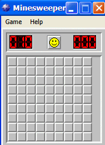
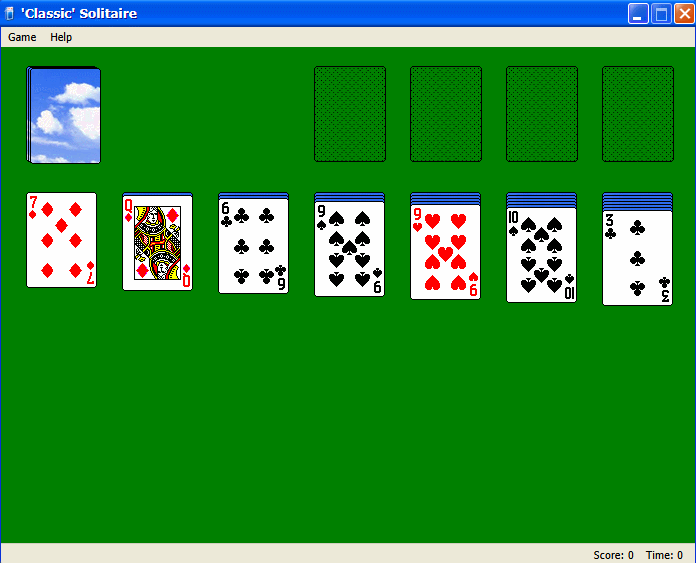
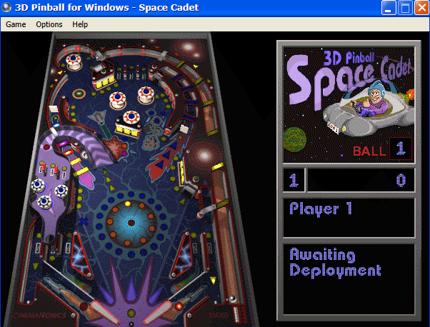

# XP Games

Windows XP 스타일 바탕화면에서 돌아가는 고전 게임 모음입니다. 지금은 지뢰찾기, 솔리테어, 3D 핀볼이 있습니다.

- **지뢰찾기:** [ShizukuIchi/winXP](https://github.com/ShizukuIchi/winXP)의 Minesweeper 앱을 REA로 분석해서, 같은 규칙으로 동작하도록 HTML/JS로 구현했습니다.
- **솔리테어:** [DualBrain/Solitaire](https://github.com/DualBrain/Solitaire)(VB.NET WinForms)를 빌드한 뒤 REA로 어셈블리를 분석하고 소스와 대조해서, 같은 규칙으로 동작하도록 HTML/JS로 구현했습니다.
- **3D 핀볼:** [webosbrew/SpaceCadetPinball](https://github.com/webosbrew/SpaceCadetPinball)(원본 `pinball.exe`의 C++ 디컴파일)의 엔진을 JS로 옮겼습니다. 게임 데이터는 저작권 때문에 포함하지 않으며, 원본 Windows XP의 파일을 직접 넣어야 합니다([3D 핀볼](#3d-핀볼) 참고).

## 실행

```
node serve.mjs
```

브라우저에서 http://localhost:3000 을 엽니다. 의존성 설치는 필요 없고 Node.js만 있으면 됩니다.

ES 모듈을 쓰기 때문에 `index.html`을 파일로 직접 열면(`file://`) 동작하지 않습니다. 반드시 서버를 띄워서 여세요.

테스트는 `npm test`로 실행합니다.

## 바탕화면과 창

#### PC

| 입력 | 동작 |
|---|---|
| 아이콘 더블클릭 | 앱 창 열기. 최소화한 창이면 다시 표시 |
| 제목 표시줄 끌기 | 창 이동 |
| 최소화 버튼 | 창 숨기기 (게임 상태 유지) |
| 닫기 버튼 / Exit 메뉴 | 창 닫기. 다시 열면 새 게임으로 시작 |
| 창 클릭 | 그 창을 맨 앞으로 가져오고 활성 창으로 만듦. 다른 창은 제목 표시줄이 흐려짐 |
| 바탕화면 클릭 | 모든 창을 비활성으로 |

#### 모바일

| 입력 | 동작 |
|---|---|
| 아이콘 탭 | 앱 창 열기 (모바일 브라우저는 더블탭을 확대에 쓰므로 한 번 탭으로 열림) |
| 제목 표시줄 끌기 | 창 이동. 게임 창이 화면보다 넓으면 끌어서 보고 싶은 부분을 맞춤 |
| 메뉴 탭 | 메뉴 열기. 하위 메뉴가 있는 항목은 탭하면 하위 메뉴가 열림 |
| 그 밖의 버튼, 창, 바탕화면 탭 | PC의 클릭과 같음 |

## 구조

```
xp-games/
├── shared/                     # 모든 앱이 같이 쓰는 부분
│   ├── css/
│   │   └── xp.css              # 바탕화면, 아이콘, XP 창, 메뉴 막대, 대화상자 스타일
│   ├── js/
│   │   ├── desktop.js          # 아이콘 표시, 앱 열기/최소화/닫기
│   │   ├── window.js           # XP 창(끌기, 버튼, 앞으로 가져오기, 활성 창 추적), 모달 대화상자
│   │   └── menu.js             # 드롭다운 메뉴 막대와 하위 메뉴 (winXP DropDowns 이식)
│   └── assets/                 # 메뉴 체크 표시 이미지, winXP 라이선스
├── apps/                       # 앱별로 따로 쓰는 부분
│   ├── registry.js             # 바탕화면에 올릴 앱 목록
│   ├── about/                  # About XP Games 창 (소개 문구, GitHub 링크)
│   ├── minesweeper/
│   │   ├── app.js              # 렌더링, 마우스/터치 입력, 메뉴
│   │   ├── game.js             # 순수 게임 로직 (원본 reducer와 1:1 대응)
│   │   ├── style.css
│   │   └── assets/
│   ├── solitaire/
│   │   ├── app.js              # 렌더링, 마우스/터치 입력, 메뉴, 타이머
│   │   ├── game.js             # 순수 게임 로직 (원본 GameForm.vb 규칙)
│   │   ├── layout.js           # 판 좌표와 클릭/드롭 판정 (원본 FindHit, HoverTest)
│   │   ├── win-effect.js       # 승리 애니메이션 (원본 Win, WinAlgorithm)
│   │   ├── dialogs.js          # Options, Deck, Deal Again, About 대화상자
│   │   ├── style.css
│   │   └── assets/
│   └── pinball/
│       ├── app.js              # 창, 메뉴, 키/마우스/터치 입력, 프레임 루프, 데이터 읽기
│       ├── dialogs.js          # High Scores, Player Controls, About 대화상자
│       ├── engine/             # 원본 C++ 파일과 1:1로 대응하는 엔진
│       │   ├── dat.js          # PINBALL.DAT 읽기 (partman, GroupData, 팔레트)
│       │   ├── render.js       # 소프트웨어 렌더러 (gdrv, zdrv, render, proj)
│       │   ├── edges.js        # 충돌 격자, 선/원/플리퍼 (TEdgeManager, TLine, TFlipperEdge ...)
│       │   ├── components.js   # 테이블 부품 (TBall, TFlipper, TPlunger, TBumper ... TPinballTable)
│       │   ├── control.js      # 미션, 점수, 조명 규칙 (control.cpp)
│       │   ├── pb.js           # 게임 루프와 상태 (pb, score, nudge, high_score)
│       │   ├── loader.js
│       │   ├── timer.js
│       │   ├── maths.js
│       │   ├── strings.js
│       │   └── pe.js
│       ├── data/               # 사용자가 넣는 원본 데이터 (git 제외)
│       ├── style.css
│       └── assets/
├── tests/                      # 앱별 로직 테스트
├── index.html                  # 바탕화면 페이지 (공용 셸만 불러옴)
└── serve.mjs                   # 로컬 정적 파일 서버 (포트 3000)
```

### 앱 추가하기

1. `apps/<id>/app.js`를 만들고 `mount(body, ctx)`를 export합니다. `body`는 창 안쪽 요소입니다. `ctx.window`는 창 객체(대화상자를 띄울 때 사용), `ctx.close()`는 창을 닫는 함수입니다. `mount`는 `{ unmount() }`를 반환해야 하고, `unmount`에서 타이머와 `window`에 단 이벤트를 정리합니다.
2. `apps/registry.js`에 `{ id, label, title, icon, style, x, y, load }` 항목을 추가합니다.

메뉴 막대가 필요하면 `shared/js/menu.js`의 `createMenuBar`를, 대화상자가 필요하면 `shared/js/window.js`의 `openDialog`를 씁니다.

## 지뢰찾기



### 조작법

#### PC

| 입력 | 동작 |
|---|---|
| 왼쪽 클릭 | 칸 열기. 0인 칸은 주변으로 연쇄해서 열림 |
| 오른쪽 클릭 | 덮임 → 깃발 → ? → 덮임 순서로 표시 변경 |
| 왼쪽+오른쪽 동시 클릭 | 숫자 칸 주변의 깃발 수가 숫자와 같으면 주변 칸을 모두 엶 |
| 얼굴 버튼 | 같은 난이도로 새 게임 |
| Game 메뉴 | New, Beginner / Intermediate / Expert, Exit |

#### 모바일

| 입력 | 동작 |
|---|---|
| 덮인 칸 탭 | 칸 열기 (PC의 왼쪽 클릭) |
| 칸 길게 누르기 (0.4초) | 덮임 → 깃발 → ? → 덮임 순서로 표시 변경 (PC의 오른쪽 클릭). 지원하는 기기는 짧게 진동 |
| 열린 숫자 칸 탭 | 주변 칸 모두 열기 (PC의 왼쪽+오른쪽 동시 클릭) |
| 얼굴 버튼 탭 | 같은 난이도로 새 게임 |
| Game 메뉴 | PC와 같음 |

누른 채로 손가락을 10px 넘게 움직이면 그 입력은 취소됩니다.

### 게임 규칙

- **난이도:** 초급 9×9 / 지뢰 10, 중급 16×16 / 40, 고급 16×30 / 99.
- **첫 클릭:** 지뢰는 첫 클릭 순간에 배치됩니다. 클릭한 칸만 제외되므로 첫 칸은 지뢰가 아니지만 숫자일 수는 있습니다.
- **연쇄 열기:** 깃발 칸에서는 멈추고, ? 칸은 열립니다.
- **동시 클릭:** 깃발을 잘못 꽂아서 깃발 없는 지뢰가 있으면 그 지뢰를 밟습니다.
- **승리:** 안전한 칸을 모두 열면 승리하고, 남은 지뢰에 깃발이 자동으로 꽂힙니다.
- **패배:** 모든 지뢰를 공개하고, 잘못 꽂은 깃발은 X로 표시합니다.
- **지뢰 카운터:** 전체 지뢰 − 깃발 수입니다. 음수가 되면 `-03`처럼 표시합니다.
- **타이머:** 첫 클릭 때 0부터 시작해 1초마다 오르고, 999에서 멈춥니다.

### 원본과의 차이

- **동시 클릭 버그 수정:** 원본은 `if (mineIndex)`로 검사해서 0번 칸(왼쪽 위)의 지뢰를 놓쳤습니다. 이 버전은 그 경우에도 게임 오버가 됩니다.
- **연쇄 열기 구현:** 재귀 대신 반복문으로 바꿨습니다. 결과는 같습니다.
- **창 동작:** 원본은 winXP 데스크톱 안의 창이었습니다. 이 버전은 공용 셸(`shared/`)이 창 끌기, 닫기, 최소화, 바탕화면 아이콘을 맡습니다.
- **미구현 항목:** Custom, Sound, Best Times, Help 메뉴와 F2 단축키는 원본에서도 동작하지 않아서 똑같이 비워 두었습니다.

## 솔리테어



### 분석 방법

저장소에는 VB.NET 소스만 있어서, `dotnet build`로 `solitaire.dll`을 만든 뒤 REA의 managed 어셈블리 분석(`inspect_managed_artifact`, `inspect_managed_members`)으로 타입, 메서드, 문자열 리터럴을 확인했습니다. 게임 로직은 `GameForm` 클래스(메서드 167개)에 모여 있고, 설정은 `Settings`, 대화상자는 `OptionsDialog`, `CardBackDialog`, `DealAgainDialog`입니다. 세부 규칙은 이 클래스들의 소스와 디자이너 파일(컨트롤 위치, 크기, 순서)에서 가져왔습니다.

### 조작법

#### PC

| 입력 | 동작 |
|---|---|
| 덱 클릭 | 카드 1장 또는 3장 넘기기. 덱이 비면 빈 칸(O)이 되고, 한 번 더 클릭하면 넘긴 카드를 다시 덱으로 |
| 카드 끌기 | 앞면 카드(아래 카드 포함)를 다른 줄이나 위쪽 칸으로 옮기기 |
| 줄 클릭 | 맨 위가 뒷면이면 뒤집기 |
| 카드 더블클릭 | 그 카드를 위쪽 칸(파운데이션)으로 보내기 |
| 오른쪽 클릭 | 올릴 수 있는 카드를 전부 위쪽 칸으로 |
| Game 메뉴 | Deal, Undo, Deck..., Options..., Exit |
| Help 메뉴 | About만 동작 |

#### 모바일

| 입력 | 동작 |
|---|---|
| 덱 탭 | 카드 넘기기 (PC의 덱 클릭과 같음) |
| 카드 끌기 | 카드 옮기기. 6px 넘게 움직여야 끌기로 인식해서, 살짝 흔들린 탭은 탭으로 처리 |
| 줄 탭 | 맨 위가 뒷면이면 뒤집기 |
| 카드 더블탭 (0.4초 안에 같은 자리) | 그 카드를 위쪽 칸으로 보내기 |
| Game / Help 메뉴 | PC와 같음 |

오른쪽 클릭에 해당하는 "전부 위쪽 칸으로" 동작은 모바일에 없습니다. 카드를 한 장씩 더블탭해서 올립니다.

### 게임 규칙

- **배치:** 일곱 줄에 1~7장을 깔고 각 줄의 맨 위만 앞면입니다. 남은 24장이 덱입니다.
- **넘기기:** 기본은 3장씩(Draw Three)이고, 마지막 3장만 펼쳐서 보입니다. 맨 위 카드만 옮길 수 있습니다.
- **줄 쌓기:** 색이 다르고 숫자가 하나 작은 카드를 올립니다. 빈 줄에는 K만 놓을 수 있습니다.
- **위쪽 칸:** 빈 칸에는 A, 그 위에는 같은 무늬로 하나 큰 카드를 한 장씩 올립니다. 위쪽 칸의 카드를 다시 줄로 내릴 수 있습니다.
- **자동 뒤집기 없음:** 카드를 옮겨서 뒷면 카드가 드러나도 직접 클릭해야 뒤집힙니다.
- **드롭 판정:** 끌고 있는 카드 영역이 대상 칸과 겹치면 놓입니다. 두 칸에 걸치면 원본 컨트롤 순서(6, 5, 4, 2, 1, 0번 줄, 위쪽 1, 0번, 3번 줄, 위쪽 3, 2번)대로 먼저 놓일 수 있는 칸에 놓입니다.
- **Undo:** 한 단계만 되돌립니다. 카드 뒤집기는 되돌릴 수 없고, 오른쪽 클릭으로 여러 장을 올렸으면 마지막 한 장만 되돌립니다.
- **승리:** 52장이 모두 위쪽 칸에 올라가면 카드가 튀어 내려오는 애니메이션이 나오고 "Deal Again?"을 묻습니다.

### 점수

| 상황 | Standard | Vegas |
|---|---|---|
| 새 게임 | 0 | −$52 (Cumulative면 이전 점수에 −52) |
| 넘긴 카드 → 줄 | +5 | |
| 위쪽 칸에 올리기 (끌기, 더블클릭) | +10 | +$5 |
| 위쪽 칸에 올리기 (오른쪽 클릭) | 장당 +10 | |
| 위쪽 칸 → 줄 | −15 | |
| 뒷면 카드 뒤집기 | +5 | |
| 덱 다시 넘기기 | Draw Three: 세 번째부터 −20, Draw One: 매번 −100 | |
| 10초마다 (Timed game) | −2 | −$2 |

- Standard 점수는 0 아래로 내려가지 않습니다. Vegas 점수가 음수면 빨간색으로 표시합니다.
- Undo의 점수 조정도 원본 계산을 그대로 따릅니다. 그래서 Vegas에서 위쪽 칸 → 줄 이동을 되돌리면 +$5가 됩니다.

### 옵션

- **Draw One / Draw Three, Timed game, Scoring:** 바꾸면 새 게임을 시작합니다. Vegas와 Cumulative 사이 전환은 예외입니다.
- **Status bar, Outline dragging:** 바로 적용됩니다. Outline dragging을 켜면 카드 대신 회색 테두리가 끌려 다닙니다.
- **Deck:** 카드 뒷면 12종 중 하나를 고르면 새 게임을 시작합니다.
- 설정은 브라우저 `localStorage`에 저장됩니다. 원본은 `settings.xml` 파일에 저장했습니다.

### 원본과의 차이

원본 동작을 최대한 그대로 옮겼고, 게임 상태가 깨지거나 게임이 끝나지 않는 버그만 고쳤습니다.

- **실패한 드롭이 Undo를 덮어쓰던 버그 수정:** 원본은 카드를 놓을 수 없는 줄 위에서 놓아도 Undo 정보를 그 이동으로 바꿔서, 이후 Undo가 카드를 복제하거나 지웠습니다. 이 버전은 실제로 옮긴 경우에만 Undo를 기록합니다.
- **Draw Three Undo 버그 수정:** 원본은 덱의 마지막 카드를 넘긴 직후 Undo하면 카드 한 장을 잃었습니다. 이 버전은 넘기기 전 상태를 그대로 되돌립니다.
- **원래 자리에 놓기:** 원본은 연산자 우선순위 때문에 원래 칸 제외 검사가 일부 경우에만 적용되어, 위쪽 칸의 카드를 살짝 끌어 같은 칸에 다시 놓으면 점수가 계속 올랐습니다. 이 버전은 원래 칸에 놓으면 항상 이동을 취소합니다.
- **오른쪽 클릭으로 끝낸 게임:** 원본은 오른쪽 클릭으로 마지막 카드를 올리면 승리 처리를 하지 않았습니다. 이 버전은 승리 애니메이션을 보여 줍니다.
- **승리 후 타이머:** 원본은 이긴 뒤에도 시계가 돌며 점수가 깎였습니다. 이 버전은 이기면 시계를 멈춥니다.
- **Deal Again에서 No:** 원본은 애니메이션 화면이 판을 계속 가렸습니다. 이 버전은 완성된 판을 보여 주고, Deal로 새 게임을 시작할 수 있습니다.
- **창 크기:** 원본은 창 크기를 바꿀 수 있었지만 이 버전은 원본 기본 크기에 맞춘 고정 크기입니다. 카드 배치 간격은 원본이 기본 크기에서 계산하는 값과 같습니다.
- **미구현 항목:** Help의 Contents, Search, How to Use Help는 Windows 도움말 파일(`.chm`)을 여는 기능이라 비워 두었습니다. About은 Windows 기본 정보 창 대신 간단한 대화상자로 보여 줍니다.

## 3D 핀볼



### 게임 데이터 넣기

테이블 그림, 충돌 형상, 부품 배치는 모두 Microsoft의 `PINBALL.DAT`에 들어 있어서 저장소에 포함하지 않았습니다. Windows XP의 `C:\Program Files\Windows NT\Pinball\`에서 아래 파일을 `apps/pinball/data/`에 복사합니다. 이 폴더는 git에서 제외되므로, 사이트를 배포할 때는 서버에 따로 올려야 합니다.

| 파일 | 필요 여부 | 용도 |
|---|---|---|
| `PINBALL.DAT` | 필수 | 테이블 전체 |
| `PINBALL.EXE` | 권장 | 메시지용 비트맵 글꼴(`PBMSG_FT` 리소스). 없으면 흰색 기본 글꼴로 표시 |
| `*.WAV` | 권장 | 소리는 재생하지 않고 길이만 읽음. 일부 타이머가 효과음 길이만큼 기다리기 때문 |

파일 이름은 대문자든 소문자든 상관없습니다.

### 분석 방법

저장소에는 실행 파일이 없고, 이 PC에는 C++ 빌드 도구가 없어서 REA로 분석할 바이너리를 만들 수 없었습니다. 그래서 원본 `pinball.exe`를 디컴파일한 엔진 소스를 직접 읽어 옮겼습니다. 사용자 `pinball.exe`는 REA의 PE 리소스 분석(`inspect_pe_resources`)으로 확인했습니다. 메시지 글꼴이 `PBMSG_FT` RCDATA 리소스(21,702바이트)에 있고, 디컴파일 저장소의 `PB_MSGFT.bin`과 SHA-256이 같습니다. 이 PC에는 디스어셈블러(Ghidra/IDA/objdump)가 설정되지 않아 코드 수준의 대조는 하지 못했습니다.

엔진 구조는 이렇습니다.

- **데이터:** `PINBALL.DAT`은 그룹 목록이고, 그룹마다 그림, 깊이 맵, 실수 배열(충돌 형상, 물리 값), 정수 배열(부품 목록)이 들어 있습니다.
- **화면:** 600×416 화면에 부품 그림을 깊이 맵으로 겹쳐 그리고, 바뀐 영역만 다시 그립니다.
- **물리:** 초당 120번 갱신합니다. 공을 광선처럼 쏘아 10×15 격자 안의 선, 원, 움직이는 플리퍼와 부딪히는지 계산합니다.
- **규칙:** 부품이 메시지 코드를 보내면(예: 63은 공이 부딪힘) `control` 모듈이 점수, 조명, 미션 상태를 바꿉니다.

### 조작법

#### PC

| 입력 | 동작 |
|---|---|
| Z / 마우스 왼쪽 | 왼쪽 플리퍼 |
| / / 마우스 오른쪽 | 오른쪽 플리퍼 |
| 스페이스 / 마우스 가운데 | 플런저 (누르고 있다가 놓기) |
| X / . / ↑ | 테이블 왼쪽 / 오른쪽 / 아래쪽 흔들기 (너무 많이 흔들면 TILT) |
| F2 | 새 게임 |
| F3 | 일시정지 / 계속 |
| F8 | Player Controls (키 바꾸기) |
| Esc | 창 최소화 (원본 동작) |
| Game 메뉴 | New Game, Launch Ball, Pause/Resume, High Scores, Demo, Exit |
| Options 메뉴 | Select Players (1~4명), Player Controls |

#### 모바일

테이블 아래쪽에 터치 영역이 세 개 있고, 터치 기기에서는 흐린 점선으로 표시됩니다. 영역은 테이블을 불러온 뒤 플리퍼와 플런저 그림의 실제 위치로 계산합니다.

| 터치 영역 | 위치 (화면 600×416 기준) | 동작 |
|---|---|---|
| 왼쪽 플리퍼 | 플리퍼 위 60px부터 바닥까지, 테이블 왼쪽 끝 ~ 두 플리퍼 사이 (x 0~182) | 누르는 동안 왼쪽 플리퍼 올림 |
| 오른쪽 플리퍼 | 같은 높이, 두 플리퍼 사이 ~ 플런저 통로 앞 (x 182~316) | 누르는 동안 오른쪽 플리퍼 올림 |
| 플런저 | 플런저 위 80px부터 바닥까지, 플런저 통로 (x 316~365) | 길게 누르면 스프링이 당겨지고, 손을 떼면 공 발사. 오래 누를수록 세게 나감 |

- 손가락마다 따로 인식하므로 두 손가락으로 양쪽 플리퍼를 동시에 쓸 수 있습니다.
- 게임 오버 상태에서는 화면 아무 곳이나 탭해도 PC의 클릭과 같이 반응합니다.
- 테이블 흔들기, 키 단축키(F2, F3, F8, Esc)는 모바일에 없습니다. 새 게임, 일시정지, 공 발사는 Game 메뉴로 합니다.

창이 비활성이면 게임이 멈춥니다(원본도 포커스를 잃으면 멈춤). 치트 코드(`hidden test`, `1max`, `bmax`, `gmax`, `rmax`)도 원본처럼 입력할 수 있고, 쓰면 그 게임의 점수는 최고 점수에 오르지 않습니다.

### 원본과의 차이

- **소리:** 재생하지 않습니다. WAV 파일이 있으면 길이만 읽어 원본과 같은 대기 시간을 씁니다.
- **실수 정밀도:** 원본은 32비트 `float`, 이 버전은 64비트 숫자로 계산합니다. 공 궤적이 아주 미세하게 다를 수 있습니다.
- **범퍼 업그레이드 감소:** 원본 `BumperGroupControl`은 범위를 벗어난 메모리를 읽습니다. 의도대로 첫 번째 범퍼의 상태를 확인하도록 했습니다.
- **격자 배치 안전장치:** 선을 격자에 배치하는 반복문에 횟수 제한을 두었습니다. 실수 정밀도 차이로 끝 칸을 지나치면 무한 반복할 수 있어서입니다.
- **창:** 크기 고정(600×416)입니다. 원본의 Full Screen, Sound/Music, 해상도 선택, Help Topics 메뉴는 넣지 않았습니다.
- **최고 점수와 설정:** 레지스트리/ini 대신 브라우저 `localStorage`에 저장합니다.

## 라이선스

이 저장소의 코드는 MIT 라이선스입니다([LICENSE](LICENSE)). 다른 프로젝트에서 가져온 부분은 각 프로젝트의 라이선스를 따릅니다.

- 지뢰찾기 이미지와 XP 창/메뉴 스타일: winXP 저장소(MIT, © 2019 Shizuku Yang). `apps/minesweeper/assets/LICENSE-winXP`, `shared/assets/LICENSE-winXP`
- 솔리테어 카드 이미지와 아이콘: DualBrain/Solitaire(MIT, © Cory Smith). `apps/solitaire/assets/LICENSE-Solitaire`
- 3D 핀볼 엔진: SpaceCadetPinball(MIT, © 2020-2021 Andrey Muzychenko)을 옮긴 코드와 아이콘. `apps/pinball/LICENSE-SpaceCadetPinball`. 게임 데이터(`PINBALL.DAT` 등)는 Microsoft 소유이며 포함하지 않습니다.
